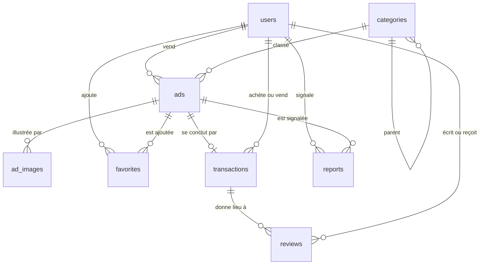

# LeBonDeal — Base SQL (PostgreSQL)

> Partie 2/5 du dossier de conception. Vue d'ensemble : [`2026-10-26-lebondeal-design.md`](../superpowers/specs/2026-10-26-lebondeal-design.md). Compagnon : [03 — MongoDB](03-mongodb.md).
> Le script SQL et les requêtes de ce document ont été exécutés sur PostgreSQL 17 (voir § 10).

## 1. Pourquoi PostgreSQL, et ce qui y vit

Le sujet demande « du SQL et du NoSQL avec Mongo ». Le choix du moteur SQL n'était pas imposé : **j'ai choisi PostgreSQL** (c'est ma décision, à valider). Raisons : la recherche plein texte en français, les types énumérés, la recherche par distance et les index partiels sont intégrés ou livrés avec le moteur, ce qui évite d'ajouter un moteur de recherche externe. Si votre cours impose MySQL/MariaDB, dites-le : le modèle relationnel reste valable, mais ces fonctions seraient à réécrire (recherche `FULLTEXT`, distance via `ST_Distance_Sphere`).

PostgreSQL est la **source de vérité** : ce qui doit être **unique, cohérent, relié par des clés étrangères, ou modifié en transaction** vit ici.

| Donnée | Pourquoi dans le SQL |
|---|---|
| Utilisateurs | e-mail unique, rôle, base de toutes les relations |
| Catégories (arbre) | hiérarchie parent/enfant, requête récursive |
| Annonces (champs communs) | filtres, tri, pagination, recherche plein texte et géographique |
| Photos | ordre garanti, suppression en cascade avec l'annonce |
| Favoris | relation plusieurs-à-plusieurs, clé primaire composite |
| Ventes et avis | un avis seulement entre les deux parties d'une vente réelle (contraintes + trigger) |
| Signalements | file de modération avec statuts |

Les champs propres à une catégorie (kilométrage d'une voiture, surface d'un logement…), la messagerie et les statistiques sont dans MongoDB : voir le document 03.

## 2. Modèle de données



| Table | Rôle | Contraintes à retenir |
|---|---|---|
| `users` | comptes | `email citext UNIQUE` (insensible à la casse), `role` énuméré (`user`/`admin`), `is_banned` |
| `categories` | arbre à deux niveaux (`parent_id` NULL = racine) | `slug UNIQUE`, `ON DELETE RESTRICT` (on ne supprime pas une catégorie utilisée) |
| `ads` | annonces | `price_cents >= 0`, `lat`/`lng` ensemble ou absents, `status` énuméré, colonne `search_vector` **générée** |
| `ad_images` | photos (10 maximum) | `position 0..9`, `UNIQUE (ad_id, position) DEFERRABLE` |
| `favorites` | favoris | clé primaire `(user_id, ad_id)` |
| `transactions` | « vendue à X » | `ad_id UNIQUE` (une vente par annonce), `seller_id <> buyer_id` |
| `reviews` | avis 1 à 5 | `UNIQUE (transaction_id, reviewer_id)`, trigger : auteur et destinataire = les deux parties de la vente |
| `reports` | signalements | au moins une cible (`ad_id` ou `reported_user_id`) |

**Conventions** (à respecter partout, elles évitent des bugs classiques) :

- Identifiants `uuid` pour `users` et `ads` : non devinables dans les URL, et utilisables tels quels comme références depuis MongoDB.
- **Prix en centimes, entiers** (`12,50 €` = `1250`). Jamais de `float` pour l'argent. Maximum ≈ 21 M€ (`integer`) : suffisant ici.
- Dates en `timestamptz` (avec fuseau). Le frontend formate avec `Intl`.
- Colonnes en `snake_case` dans le SQL, `camelCase` dans l'API JSON ; la conversion est faite à un seul endroit (`camelize` dans `postgres.js`).
- Suppression d'une annonce : `status = 'deleted'` + `deleted_at` (suppression logique), pour garder l'historique des ventes et des signalements.
- `ON DELETE CASCADE` du côté « dépendant » (photos, favoris) ; la suppression d'un utilisateur emporte ses annonces, ventes et avis (vérifié). **MongoDB ne suit pas cette cascade** : le backend doit nettoyer les documents liés (voir document 03, § 7).

## 3. Le script de création

Il est exécuté automatiquement par le conteneur au premier démarrage (`database/postgres/init/`, fichiers lus par ordre alphabétique).

**`database/postgres/init/01-schema.sql`**

```sql
-- LeBonDeal : schéma PostgreSQL
-- PostgreSQL est la source de vérité : identités, annonces, favoris, ventes, avis, signalements.
-- Ce script ne s'exécute qu'au PREMIER démarrage du volume pgdata (voir « Réinitialiser les bases »).

-- ─── Extensions ──────────────────────────────────────────────────────────────
CREATE EXTENSION IF NOT EXISTS citext;         -- e-mails insensibles à la casse
CREATE EXTENSION IF NOT EXISTS unaccent;       -- « velo » doit trouver « vélo »
CREATE EXTENSION IF NOT EXISTS pg_trgm;        -- recherche floue (fautes de frappe)
CREATE EXTENSION IF NOT EXISTS cube;           -- requis par earthdistance
CREATE EXTENSION IF NOT EXISTS earthdistance;  -- distance entre deux points GPS (recherche par rayon)

-- Configuration de recherche plein texte : français + insensible aux accents
CREATE TEXT SEARCH CONFIGURATION french_unaccent (COPY = french);
ALTER TEXT SEARCH CONFIGURATION french_unaccent
  ALTER MAPPING FOR hword, hword_part, word WITH unaccent, french_stem;

-- ─── Types énumérés ──────────────────────────────────────────────────────────
CREATE TYPE user_role     AS ENUM ('user', 'admin');
CREATE TYPE ad_status     AS ENUM ('draft', 'active', 'reserved', 'sold', 'archived', 'deleted');
CREATE TYPE ad_condition  AS ENUM ('new', 'like_new', 'good', 'fair', 'for_parts');
CREATE TYPE report_status AS ENUM ('open', 'dismissed', 'actioned');

-- ─── Mise à jour automatique de updated_at ───────────────────────────────────
CREATE FUNCTION set_updated_at() RETURNS trigger LANGUAGE plpgsql AS $$
BEGIN
  NEW.updated_at = now();
  RETURN NEW;
END $$;

-- ─── Utilisateurs ────────────────────────────────────────────────────────────
CREATE TABLE users (
  id                uuid PRIMARY KEY DEFAULT gen_random_uuid(),
  email             citext      NOT NULL UNIQUE,
  password_hash     text        NOT NULL,
  display_name      varchar(60) NOT NULL CHECK (char_length(display_name) >= 2),
  avatar_url        text,
  phone             varchar(20),
  bio               text,
  city              varchar(120),
  postal_code       varchar(10),
  role              user_role   NOT NULL DEFAULT 'user',
  is_banned         boolean     NOT NULL DEFAULT false,
  email_verified_at timestamptz,
  created_at        timestamptz NOT NULL DEFAULT now(),
  updated_at        timestamptz NOT NULL DEFAULT now()
);
CREATE TRIGGER users_updated_at BEFORE UPDATE ON users
  FOR EACH ROW EXECUTE FUNCTION set_updated_at();

-- ─── Catégories (arbre à 2 niveaux : parent_id NULL = catégorie racine) ─────
CREATE TABLE categories (
  id        integer GENERATED ALWAYS AS IDENTITY PRIMARY KEY,
  parent_id integer     REFERENCES categories(id) ON DELETE RESTRICT,
  slug      varchar(80) NOT NULL UNIQUE,
  name      varchar(80) NOT NULL,
  icon      varchar(40),                      -- nom d'icône lucide-react, ex. 'car'
  position  integer     NOT NULL DEFAULT 0
);
CREATE INDEX categories_parent_idx ON categories (parent_id);

-- ─── Annonces ────────────────────────────────────────────────────────────────
-- Les champs propres à une catégorie (kilométrage, surface, taille…) vivent dans MongoDB
-- (collection ad_details), reliés par ads.id.
CREATE TABLE ads (
  id                 uuid PRIMARY KEY DEFAULT gen_random_uuid(),
  seller_id          uuid          NOT NULL REFERENCES users(id) ON DELETE CASCADE,
  category_id        integer       NOT NULL REFERENCES categories(id),
  title              varchar(120)  NOT NULL CHECK (char_length(title) >= 3),
  description        text          NOT NULL CHECK (char_length(description) >= 10),
  price_cents        integer       NOT NULL CHECK (price_cents >= 0),   -- 12,50 € = 1250
  item_condition     ad_condition,
  status             ad_status     NOT NULL DEFAULT 'active',
  city               varchar(120)  NOT NULL,
  postal_code        varchar(10)   NOT NULL,
  lat                double precision CHECK (lat BETWEEN -90 AND 90),
  lng                double precision CHECK (lng BETWEEN -180 AND 180),
  shipping_available boolean       NOT NULL DEFAULT false,
  published_at       timestamptz   NOT NULL DEFAULT now(),              -- « remonter l'annonce » = mettre à jour
  expires_at         timestamptz   NOT NULL DEFAULT now() + interval '60 days',
  created_at         timestamptz   NOT NULL DEFAULT now(),
  updated_at         timestamptz   NOT NULL DEFAULT now(),
  deleted_at         timestamptz,
  search_vector      tsvector GENERATED ALWAYS AS (
    setweight(to_tsvector('french_unaccent', coalesce(title, '')), 'A') ||
    setweight(to_tsvector('french_unaccent', coalesce(description, '')), 'B')
  ) STORED,
  CHECK ((lat IS NULL) = (lng IS NULL))
);
CREATE TRIGGER ads_updated_at BEFORE UPDATE ON ads
  FOR EACH ROW EXECUTE FUNCTION set_updated_at();

CREATE INDEX ads_feed_idx       ON ads (published_at DESC) WHERE status = 'active';
CREATE INDEX ads_category_idx   ON ads (category_id, published_at DESC) WHERE status = 'active';
CREATE INDEX ads_seller_idx     ON ads (seller_id, status);
CREATE INDEX ads_price_idx      ON ads (price_cents) WHERE status = 'active';
CREATE INDEX ads_search_idx     ON ads USING gin (search_vector);
CREATE INDEX ads_title_trgm_idx ON ads USING gin (title gin_trgm_ops);
CREATE INDEX ads_geo_idx        ON ads USING gist (ll_to_earth(lat, lng));

-- ─── Photos des annonces ─────────────────────────────────────────────────────
CREATE TABLE ad_images (
  id         uuid PRIMARY KEY DEFAULT gen_random_uuid(),
  ad_id      uuid     NOT NULL REFERENCES ads(id) ON DELETE CASCADE,
  url        text     NOT NULL,
  thumb_url  text,
  position   smallint NOT NULL DEFAULT 0 CHECK (position BETWEEN 0 AND 9),   -- 10 photos max
  created_at timestamptz NOT NULL DEFAULT now(),
  -- DEFERRABLE : permet d'échanger deux positions dans une même transaction (réorganiser les photos)
  UNIQUE (ad_id, position) DEFERRABLE INITIALLY DEFERRED
);

-- ─── Favoris (relation N-N entre users et ads) ───────────────────────────────
CREATE TABLE favorites (
  user_id    uuid NOT NULL REFERENCES users(id) ON DELETE CASCADE,
  ad_id      uuid NOT NULL REFERENCES ads(id)   ON DELETE CASCADE,
  created_at timestamptz NOT NULL DEFAULT now(),
  PRIMARY KEY (user_id, ad_id)
);
CREATE INDEX favorites_ad_idx ON favorites (ad_id);

-- ─── Ventes : « marquer comme vendue à X » ───────────────────────────────────
CREATE TABLE transactions (
  id          uuid PRIMARY KEY DEFAULT gen_random_uuid(),
  ad_id       uuid    NOT NULL UNIQUE REFERENCES ads(id) ON DELETE CASCADE,   -- une annonce = une vente
  seller_id   uuid    NOT NULL REFERENCES users(id) ON DELETE CASCADE,
  buyer_id    uuid    NOT NULL REFERENCES users(id) ON DELETE CASCADE,
  price_cents integer NOT NULL CHECK (price_cents >= 0),
  created_at  timestamptz NOT NULL DEFAULT now(),
  CHECK (seller_id <> buyer_id)
);

-- ─── Avis : uniquement entre les deux parties d'une vente réelle ─────────────
CREATE TABLE reviews (
  id             uuid PRIMARY KEY DEFAULT gen_random_uuid(),
  transaction_id uuid     NOT NULL REFERENCES transactions(id) ON DELETE CASCADE,
  reviewer_id    uuid     NOT NULL REFERENCES users(id) ON DELETE CASCADE,
  reviewee_id    uuid     NOT NULL REFERENCES users(id) ON DELETE CASCADE,
  rating         smallint NOT NULL CHECK (rating BETWEEN 1 AND 5),
  comment        text,
  created_at     timestamptz NOT NULL DEFAULT now(),
  UNIQUE (transaction_id, reviewer_id),          -- un seul avis par personne et par vente
  CHECK (reviewer_id <> reviewee_id)
);
CREATE INDEX reviews_reviewee_idx ON reviews (reviewee_id);

CREATE FUNCTION check_review_participants() RETURNS trigger LANGUAGE plpgsql AS $$
DECLARE
  t transactions%ROWTYPE;
BEGIN
  SELECT * INTO t FROM transactions WHERE id = NEW.transaction_id;
  IF NOT ((NEW.reviewer_id = t.buyer_id  AND NEW.reviewee_id = t.seller_id)
       OR (NEW.reviewer_id = t.seller_id AND NEW.reviewee_id = t.buyer_id)) THEN
    RAISE EXCEPTION 'Avis refusé : auteur et destinataire doivent être les deux parties de la vente';
  END IF;
  RETURN NEW;
END $$;
CREATE TRIGGER reviews_participants BEFORE INSERT ON reviews
  FOR EACH ROW EXECUTE FUNCTION check_review_participants();

-- ─── Signalements (modération) ───────────────────────────────────────────────
CREATE TABLE reports (
  id               uuid PRIMARY KEY DEFAULT gen_random_uuid(),
  reporter_id      uuid        NOT NULL REFERENCES users(id) ON DELETE CASCADE,
  ad_id            uuid        REFERENCES ads(id)   ON DELETE CASCADE,
  reported_user_id uuid        REFERENCES users(id) ON DELETE CASCADE,
  reason           varchar(40) NOT NULL CHECK (reason IN ('spam', 'scam', 'prohibited', 'wrong_category', 'other')),
  details          text,
  status           report_status NOT NULL DEFAULT 'open',
  handled_by       uuid        REFERENCES users(id) ON DELETE SET NULL,
  handled_at       timestamptz,
  created_at       timestamptz NOT NULL DEFAULT now(),
  CHECK (ad_id IS NOT NULL OR reported_user_id IS NOT NULL)
);
CREATE INDEX reports_open_idx ON reports (created_at) WHERE status = 'open';

-- ─── Vues ────────────────────────────────────────────────────────────────────
-- Carte d'annonce : ce dont la liste de résultats a besoin, sans la description complète.
CREATE VIEW v_ad_cards AS
SELECT a.id, a.seller_id, a.category_id, a.title, a.price_cents, a.item_condition, a.status,
       a.city, a.postal_code, a.lat, a.lng, a.shipping_available, a.published_at, a.search_vector,
       u.display_name AS seller_name,
       (SELECT i.thumb_url FROM ad_images i WHERE i.ad_id = a.id ORDER BY i.position LIMIT 1) AS cover_url
FROM ads a
JOIN users u ON u.id = a.seller_id
WHERE a.deleted_at IS NULL;

-- Note moyenne et nombre d'avis reçus par utilisateur.
CREATE VIEW v_seller_stats AS
SELECT u.id AS user_id,
       round(avg(r.rating), 1) AS rating_avg,
       count(r.id)             AS rating_count
FROM users u
LEFT JOIN reviews r ON r.reviewee_id = u.id
GROUP BY u.id;
```
**`database/postgres/init/02-seed-categories.sql`**

```sql
-- LeBonDeal : catégories de départ (6 racines, 21 sous-catégories)
-- Le champ icon contient un nom d'icône lucide-react (kebab-case) ; le frontend fait la correspondance.

INSERT INTO categories (slug, name, icon, position) VALUES
  ('vehicules',  'Véhicules',       'car',        1),
  ('immobilier', 'Immobilier',      'house',      2),
  ('multimedia', 'Multimédia',      'smartphone', 3),
  ('maison',     'Maison & Jardin', 'sofa',       4),
  ('mode',       'Mode',            'shirt',      5),
  ('loisirs',    'Loisirs',         'gamepad-2',  6);

INSERT INTO categories (parent_id, slug, name, position)
SELECT p.id, v.slug, v.name, v.position
FROM (VALUES
  ('vehicules',  'voitures',              'Voitures',                1),
  ('vehicules',  'motos',                 'Motos',                   2),
  ('vehicules',  'velos',                 'Vélos',                   3),
  ('vehicules',  'equipement-auto',       'Équipement auto',         4),
  ('immobilier', 'ventes-immobilieres',   'Ventes immobilières',     1),
  ('immobilier', 'locations',             'Locations',               2),
  ('immobilier', 'colocations',           'Colocations',             3),
  ('multimedia', 'informatique',          'Informatique',            1),
  ('multimedia', 'telephones',            'Téléphones',              2),
  ('multimedia', 'consoles-jeux-video',   'Consoles & jeux vidéo',   3),
  ('multimedia', 'image-son',             'Image & son',             4),
  ('maison',     'ameublement',           'Ameublement',             1),
  ('maison',     'electromenager',        'Électroménager',          2),
  ('maison',     'bricolage',             'Bricolage',               3),
  ('maison',     'jardinage',             'Jardinage',               4),
  ('mode',       'vetements',             'Vêtements',               1),
  ('mode',       'chaussures',            'Chaussures',              2),
  ('mode',       'montres-bijoux',        'Montres & bijoux',        3),
  ('mode',       'sacs-accessoires',      'Sacs & accessoires',      4),
  ('loisirs',    'sport',                 'Sport',                   1),
  ('loisirs',    'instruments-musique',   'Instruments de musique',  2)
) AS v(parent_slug, slug, name, position)
JOIN categories p ON p.slug = v.parent_slug;
```
## 4. Les fonctionnalités SQL à mettre en avant (rapport, soutenance)

Chacune est utilisée pour un vrai besoin du site, et testée :

| Fonctionnalité | Où | Ce que ça apporte |
|---|---|---|
| **Colonne générée** `search_vector` + index GIN + configuration `french_unaccent` | `ads` | recherche plein texte en français, qui trouve « vélo » en tapant « velo » ; un mot du titre pèse plus (poids A) qu'un mot de la description (poids B), utilisable avec `ts_rank` pour un tri par pertinence (non implémenté dans le tri livré) |
| **Extension `pg_trgm`** | `similar-title.sql` | tolérance aux fautes de frappe, détection d'annonces en double |
| **`earthdistance` + index GiST** | `search-ads.sql` | « à moins de 30 km de Lyon », sans moteur géographique externe |
| **Requête récursive** (`WITH RECURSIVE`) | `search-ads.sql` | choisir « Véhicules » inclut voitures, motos, vélos… |
| **Fonction de fenêtre** `count(*) OVER ()` | `search-ads.sql` | nombre total de résultats en une seule requête, pour la pagination |
| **`LATERAL` + `percentile_cont`** | `price-hint.sql` | badge « bon prix » : comparaison à la médiane de la catégorie |
| **Trigger** `check_review_participants` | `reviews` | impossible de laisser un avis sans avoir participé à la vente, même en contournant l'API |
| **Contrainte `DEFERRABLE`** | `ad_images` | échanger l'ordre de deux photos en une transaction, sans violer l'unicité |
| **Index partiels** (`WHERE status = 'active'`) | `ads` | index plus petits, uniquement sur les annonces visibles |
| **Vues** `v_ad_cards`, `v_seller_stats` | lecture | requêtes de listes simples ; note moyenne et nombre d'avis par vendeur |
| **`citext`** | `users.email` | `Marie@Test.fr` et `marie@test.fr` sont le même compte (vérifié) |
| **Transactions** | `withTransaction` | création d'annonce : annulée si l'écriture MongoDB échoue |

## 5. Requêtes types

Ces trois fichiers sont ceux du backend (`backend/src/sql/`). Les paramètres `$1`, `$2`… sont fournis par le code Node : **jamais de valeur collée dans le texte SQL**.

**`backend/src/sql/search-ads.sql`**

```sql
-- Recherche d'annonces : texte + catégorie (et ses sous-catégories) + prix + rayon.
-- $1 texte | $2 slug de catégorie | $3 prix min (centimes) | $4 prix max (centimes)
-- $5 latitude | $6 longitude | $7 rayon en mètres | $8 limite | $9 décalage (pagination)
-- $10 liste d'identifiants autorisés (résultat d'un filtre MongoDB sur les champs dynamiques), ou NULL
-- Un paramètre NULL désactive son filtre. Le tri (ORDER BY) est à construire côté Node
-- depuis une liste blanche (recent | price_asc | price_desc | relevance) : jamais d'entrée utilisateur brute.
WITH RECURSIVE cat AS (
  SELECT id FROM categories WHERE slug = $2
  UNION ALL
  SELECT c.id FROM categories c JOIN cat ON c.parent_id = cat.id
)
SELECT v.id, v.title, v.price_cents, v.city, v.cover_url, v.published_at,
       CASE WHEN $5::float8 IS NULL THEN NULL
            ELSE round(earth_distance(ll_to_earth($5, $6), ll_to_earth(v.lat, v.lng)) / 1000)
       END AS distance_km,
       count(*) OVER () AS total                       -- nombre total de résultats, pour la pagination
FROM v_ad_cards v
WHERE v.status = 'active'
  AND ($10::uuid[] IS NULL OR v.id = ANY($10))
  AND ($1::text   IS NULL OR v.search_vector @@ websearch_to_tsquery('french_unaccent', $1))
  AND ($2::text   IS NULL OR v.category_id IN (SELECT id FROM cat))
  AND ($3::int    IS NULL OR v.price_cents >= $3)
  AND ($4::int    IS NULL OR v.price_cents <= $4)
  AND ($5::float8 IS NULL OR (earth_box(ll_to_earth($5, $6), $7) @> ll_to_earth(v.lat, v.lng)   -- utilise l'index GiST
                              AND earth_distance(ll_to_earth($5, $6), ll_to_earth(v.lat, v.lng)) <= $7))
ORDER BY v.published_at DESC
LIMIT $8 OFFSET $9;
```
Ce que ce fichier a donné sur un jeu de test (9 annonces à Lyon et Paris) : « velo » trouve les six « Vélo… » mais pas la voiture ; la catégorie parente « vehicules » renvoie les 9 ; un rayon de 50 km autour de Lyon exclut Paris ; une fourchette 100–250 € plus « vtt » ne garde que le bon VTT.

> **Limite connue.** Le motif « paramètre NULL = filtre désactivé » est lisible, mais le planificateur de PostgreSQL ne peut pas toujours choisir le meilleur index avec lui. À volumes étudiants (des milliers d'annonces) ce n'est pas un problème. Au-delà, construire la clause `WHERE` dynamiquement en n'ajoutant que les filtres présents. Pour vérifier l'usage des index : `EXPLAIN (ANALYZE, BUFFERS) <la requête>` dans `psql`.

**`backend/src/sql/price-hint.sql`**

```sql
-- Indicateur « bon prix » : compare le prix d'une annonce à la médiane des annonces actives de sa catégorie.
-- $1 = id de l'annonce. Moins de 5 annonces comparables : pas d'avis.
SELECT a.id,
       a.price_cents,
       m.median_cents,
       CASE
         WHEN m.n < 5                              THEN 'unknown'
         WHEN a.price_cents <= m.median_cents*0.85 THEN 'good_deal'
         WHEN a.price_cents >= m.median_cents*1.15 THEN 'high'
         ELSE 'fair'
       END AS price_hint
FROM ads a
CROSS JOIN LATERAL (
  SELECT percentile_cont(0.5) WITHIN GROUP (ORDER BY s.price_cents) AS median_cents,
         count(*) AS n
  FROM ads s
  WHERE s.category_id = a.category_id AND s.status = 'active' AND s.id <> a.id
) m
WHERE a.id = $1;
```
Sur le jeu de test, un VTT à 300 € face à une médiane de 200 € est classé `high` ; un vélo électrique à 900 €, `high` aussi. Avec moins de 5 annonces comparables, le résultat est `unknown` : afficher le badge seulement si ce n'est pas le cas.

**`backend/src/sql/similar-title.sql`**

```sql
-- Recherche tolérante aux fautes de frappe (pg_trgm) : utile quand la recherche plein texte ne renvoie rien.
-- Aussi pour détecter des annonces en double : similarity(title, autre_titre) > 0.6.
-- $1 = texte saisi, ex. 'vleo'
SELECT id, title, similarity(title, $1) AS score
FROM ads
WHERE status = 'active' AND title % $1          -- opérateur % : similarité au-dessus du seuil (0,3 par défaut)
ORDER BY score DESC
LIMIT 10;
```
> `pg_trgm` ne gère pas les accents : « velo » et « Vélo » ne partagent pas tous leurs trigrammes. Utiliser la recherche plein texte en premier, et ce fichier en secours quand elle ne renvoie rien. Le seuil est réglable avec `SET pg_trgm.similarity_threshold = 0.2;`.

## 6. Utiliser PostgreSQL depuis Node

Pas d'ORM : le starter n'en utilise pas, et écrire du SQL est justement ce qu'on veut montrer. Un seul module, `pg` :

**`backend/src/config/postgres.js`**

```js
import pg from 'pg';
import { config } from './env.js';

export const pool = new pg.Pool({ connectionString: config.databaseUrl });

// Les colonnes SQL sont en snake_case, l'API JSON en camelCase : price_cents -> priceCents
const toCamel = (key) => key.replace(/_([a-z])/g, (_, letter) => letter.toUpperCase());
export const camelize = (row) => Object.fromEntries(Object.entries(row).map(([key, value]) => [toCamel(key), value]));

// Toujours des requêtes paramétrées ($1, $2…) : jamais de valeur concaténée dans le texte SQL.
export async function query(text, params) {
  const { rows } = await pool.query(text, params);
  return rows.map(camelize);
}

// Exécute `work(client)` dans une transaction : COMMIT si tout va bien, ROLLBACK si une exception est levée.
export async function withTransaction(work) {
  const client = await pool.connect();
  try {
    await client.query('BEGIN');
    const result = await work(client);
    await client.query('COMMIT');
    return result;
  } catch (error) {
    await client.query('ROLLBACK');
    throw error;
  } finally {
    client.release();
  }
}
```
- `query()` pour une requête simple ; `withTransaction()` quand plusieurs écritures doivent réussir ou échouer ensemble.
- **Toujours `$1, $2…`** : `pg` envoie les valeurs séparément du texte SQL, ce qui supprime l'injection SQL. Le tri variable (`ORDER BY`) est le seul endroit où on construit du SQL en texte, depuis une liste blanche (voir document 03, `adRepository.js`).
- Les erreurs PostgreSQL ont un code : `23505` = valeur déjà existante (`UNIQUE`), `23503` = référence inexistante (clé étrangère). `errorHandler.js` les traduit en réponses 409 et 400, ce qui évite le « vérifier puis insérer » (qui n'est pas fiable si deux requêtes arrivent en même temps).

## 7. Faire évoluer le schéma

Les scripts d'initialisation ne s'exécutent qu'au premier démarrage d'un volume. Pour la durée du projet, la règle simple :

1. Modifier `01-schema.sql` (c'est la description officielle du schéma, dans git).
2. `docker compose down -v`, `docker compose watch`, `docker compose exec backend npm run seed`.

C'est acceptable tant qu'il n'y a pas de données précieuses, ce qui est le cas : le seed recrée tout. Si vous voulez des migrations versionnées (modifier un schéma sans tout effacer), l'étape suivante est `node-pg-migrate` ; je ne l'ai pas ajouté pour ne pas alourdir le début.

## 8. Commandes utiles dans `psql`

```bash
docker compose exec postgres psql -U lebondeal -d lebondeal
```

```sql
\dt                         -- liste des tables
\d ads                      -- structure de la table ads, index et contraintes compris
\dv                         -- vues
SELECT count(*) FROM ads WHERE status = 'active';
SELECT * FROM v_seller_stats ORDER BY rating_count DESC LIMIT 5;
EXPLAIN ANALYZE SELECT id FROM ads WHERE search_vector @@ websearch_to_tsquery('french_unaccent', 'velo');
\q
```

## 9. Idées SQL pour aller plus loin

- **Vue matérialisée** des compteurs par catégorie (« Voitures (1 243) ») rafraîchie toutes les minutes, plutôt que de compter à chaque affichage.
- **Row Level Security** : faire appliquer par la base elle-même « un utilisateur ne modifie que ses annonces » (en plus du contrôle dans l'API).
- **`pg_cron`** : archiver automatiquement les annonces dont `expires_at` est dépassé.
- **PostGIS** à la place de `earthdistance` : recherche géographique plus précise et plus puissante (nécessite l'image `postgis/postgis`).
- **Colonne `jsonb`** pour les attributs dynamiques : alternative à MongoDB, intéressante à comparer dans le rapport (requêtes plus simples, mais le sujet demande MongoDB).
- **Partitionnement** de `messages`/`ad_views` : inutile à cette échelle, à citer seulement comme piste.

## 10. Ce qui a été vérifié

Sur `postgres:17-alpine` (l'image du `compose.yaml`) :

- Les deux scripts d'initialisation s'exécutent sans erreur : 8 tables, 2 vues, 6 catégories racines + 21 sous-catégories.
- Recherche : sans accent, catégorie parente, fourchette de prix, rayon géographique, faute de frappe, indicateur de prix ; puis recherche à travers l'API sur les 214 annonces du seed (texte, catégorie, tri par prix, rayon 30 km, filtres dynamiques).
- Contraintes qui **doivent refuser** : prix négatif, `lat` sans `lng`, e-mail en double (même casse différente), favori en double, avis en double, avis d'un tiers (trigger), note 6. Toutes refusées.
- Échange de positions de photos dans une transaction (`DEFERRABLE`) : accepté. Suppression d'un utilisateur : annonces, photos, ventes et avis supprimés.
- Sauvegarde / restauration `pg_dump` / `pg_restore`.

Non vérifié : performance sur de gros volumes (aucun jeu de données de plusieurs dizaines de milliers de lignes), `EXPLAIN` des index sur le seed.
